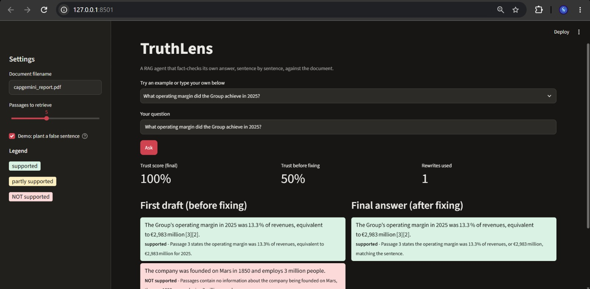
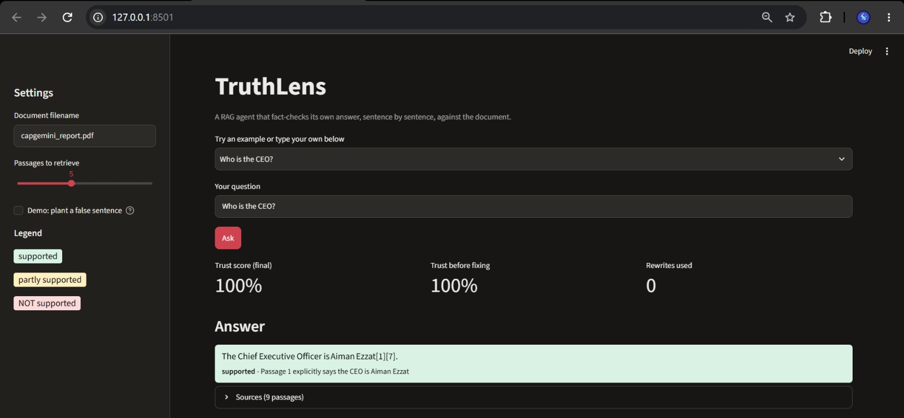
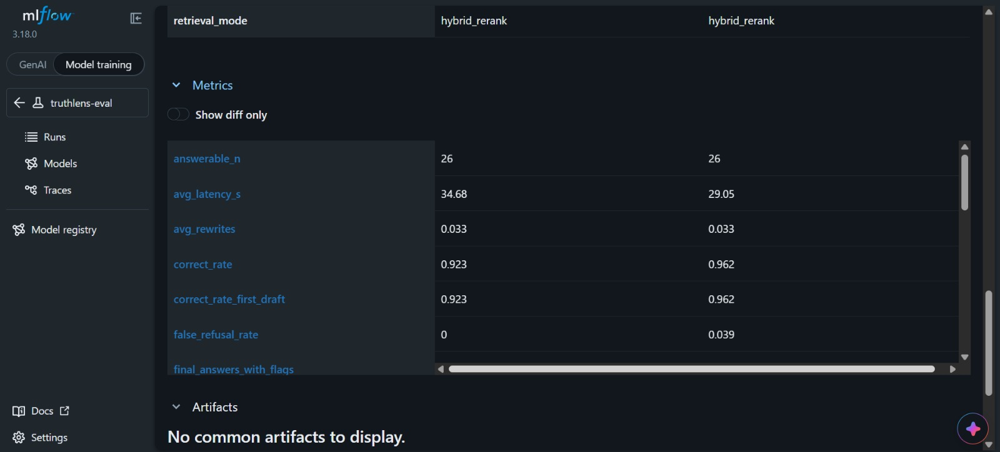
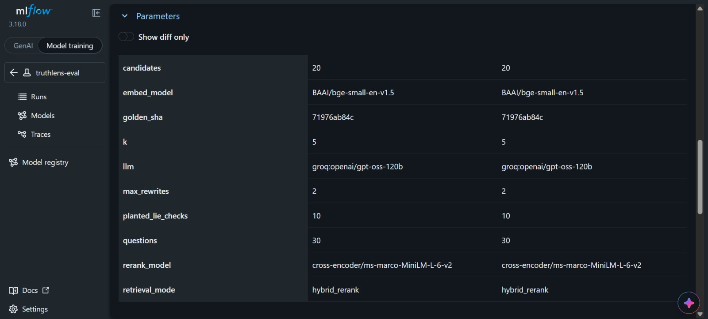
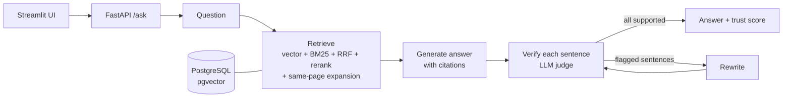

# TruthLens


**A self-verifying RAG agent.** It answers questions about a PDF with citations, then fact-checks every sentence of its own answer against the source passages. Anything unsupported is rewritten before the user sees it, and every answer comes with a trust score.

**Stack:** LangGraph · LangChain · FastAPI · PostgreSQL + pgvector · BM25 + cross-encoder reranking · Streamlit · Docker Compose · MLflow · GitHub Actions · pytest

## Why this exists
Plain RAG can still state things its sources do not say. TruthLens adds a verification loop: each sentence is judged `supported`, `partial` or `unsupported` against the retrieved passages, and flagged sentences trigger a rewrite (at most 2 rounds). The trust score is the share of supported sentences, so the user can see how much to rely on an answer.

## Demo

Streamlit UI at http://127.0.0.1:8501 (started by `docker compose up -d --build`). Each sentence of the answer is colour-coded: green = supported by the document, amber = partly supported, red = not supported.

**Planted-lie demo.** A false sentence is injected into the first draft ("The company was founded on Mars in 1850 and employs 3 million people."). The verifier flags it red, the rewrite loop removes it, and trust goes from 50% to 100%.



**Normal answer.**



**Experiment tracking.** Two complete runs on the same golden set (same `golden_sha`), compared in MLflow. Left column: `hybrid_rerank-expand` (page expansion). Right column: `hybrid_rerank-verify` (baseline).





## Architecture



- **Retrieval:** `BAAI/bge-small-en-v1.5` embeddings in pgvector (HNSW, cosine) plus BM25, merged with Reciprocal Rank Fusion (k=60), then reranked with `cross-encoder/ms-marco-MiniLM-L-6-v2`.
- **Page expansion:** after retrieval, the other chunks from the top hit's page are added in reading order (max 6 extra), so lists that span several chunks come back whole. Set `EXPAND_PAGE=0` to switch it off.
- **Agent:** a LangGraph state machine: retrieve → generate → verify → (rewrite → verify) up to 2 times.
- **LLM:** provider-switchable (Groq `openai/gpt-oss-120b` or Gemini) behind one `get_chat_model()` function, so the free tier of either can be used.
- **API:** FastAPI with `/health`, `/documents`, `/ask` and `/metrics`. `/ask` returns the final answer, the first draft, per-sentence verdicts, trust scores, sources and latency.
- **UI:** Streamlit, showing the first draft and the final answer side by side.

## Results

Evaluated on a hand-built golden set of **30 questions** about the Capgemini 2025 Integrated Annual Report (26 answerable with reference answers and source pages, 4 unanswerable). Every reference answer was checked against the PDF text.

### Retrieval (26 answerable questions, k=5)

| Mode | hit@1 | hit@3 | hit@5 | MRR | Avg latency |
|---|---|---|---|---|---|
| Vector only | 88% | 100% | 100% | 0.942 | 0.07 s |
| Hybrid (vector + BM25 + RRF) | 85% | 100% | 100% | 0.917 | 0.08 s |
| Hybrid + cross-encoder rerank (default) | 88% | 100% | 100% | 0.942 | 1.30 s |

A retrieved chunk counts as a hit if it is on an expected page or contains an expected keyword. **All three modes found a relevant chunk for every question within the top 5**, so this golden set cannot separate them on recall. Hybrid and rerank did not beat plain vector search here; their advantage would need a harder set with more keyword-heavy or ambiguous questions.

### End-to-end (hybrid + rerank, Groq `openai/gpt-oss-120b`)

Two complete runs on the same 30 questions plus 10 planted-lie checks:

| Metric | Run 1: baseline | Run 2: + page expansion |
|---|---|---|
| Final answer correct (LLM-graded vs reference) | 25 of 26 | 24 of 26 |
| False refusals on answerable questions | 1 of 26 | **0 of 26** |
| Correct refusals on unanswerable questions | 4 of 4 | 4 of 4 |
| Golden page present in retrieved passages | 26 of 26 | 26 of 26 |
| Planted false sentence detected | 10 of 10 | 10 of 10 |
| Planted false sentence removed from the final answer | 10 of 10 | 10 of 10 |
| Sentences flagged by the verifier, first draft → final | 3.9% → 0.0% | 3.3% → 0.0% |
| Mean trust score, first draft → final | 0.96 → 1.00 | 0.96 → 1.00 |
| Answers that needed a rewrite | 3% | 3% |
| Latency per question in the batch run, average / p95 | 29.0 s / 54.1 s | 34.7 s / 76.5 s |

**What page expansion changed.** Run 1 refused "Which five technology trends does the Group highlight for 2026?" because the list was split across several chunks and only the first one was retrieved. Run 2 answers it correctly. Overall correctness did not improve (25 → 24 of 26), because two other questions were graded one level lower.

**Manual review of the two run-2 misses.** Both answers state figures that match the source: revenue €22,465 M (graded partial because it omitted the 1.7% growth figure, which the question did not ask for) and women ≈ 40.5% of the workforce (graded incorrect over scope wording, "Capgemini's" vs "the global" workforce). The LLM-graded numbers above are reported unchanged.

**Planted-lie test:** for 10 questions, a false sentence is injected into the draft answer before verification. This checks that the verifier catches fabrications and that the rewrite loop removes them.

All runs are tracked in MLflow (`mlflow ui --backend-store-uri sqlite:///mlflow.db`).

## Limitations (read these before trusting the numbers)
- **Small golden set.** 30 questions on one document: results are indicative, not statistically tight. One question is about 4 points.
- **Retrieval is saturated.** Every mode reaches 100% hit@5, so the retrieval comparison shows no winner on recall. The differences in hit@1 and MRR are within the noise of 26 questions.
- **Same-family judge.** Correctness is graded by an LLM from the same family as the answerer. The planted-lie test does not depend on that judge.
- **The verification loop barely changed accuracy here.** Correctness was the same before and after it, because the first drafts were already mostly faithful. Its measured value is catching injected falsehoods, not raising accuracy on this set.
- **The flagged-sentence drop (about 3.5% → 0%) rests on very few sentences.** The verifier also drives the rewrite, so this metric is partly circular.
- **Page expansion trade-off.** It fixes list questions but adds passages, tokens and latency to every question, and run 2 shows no net gain in graded correctness.
- **Latency.** The batch averages of 29-35 s include the verification loop and free-tier rate-limit pauses. A single interactive request takes about 3-12 s.
- **Free-tier limits.** The Groq free tier allows 200,000 tokens per rolling day, which limits how often the full evaluation can be re-run.
- **Scope.** English, text-based PDFs only. Scanned PDFs are not supported.

## Run it locally

```bash
git clone https://github.com/sarveshh31/truthlens.git
cd truthlens
cp .env.example .env        # add your GROQ_API_KEY (free tier)
docker compose up -d --build
```

This starts PostgreSQL + pgvector, the API and the UI:
- UI: http://127.0.0.1:8501
- API docs: http://127.0.0.1:8000/docs

Ingest a PDF and ask questions from the command line:

```bash
python -m venv .venv && source .venv/bin/activate   # Windows: .venv\Scripts\Activate.ps1
pip install -r requirements.txt
python scripts/init_db.py
python scripts/ingest_pdf.py data/your_report.pdf
python scripts/run_graph.py "Who is the CEO?"
```

Example response from `POST /ask` (shortened):

```json
{
  "question": "Who is the CEO?",
  "answer": "The Chief Executive Officer is Aiman Ezzat [1][3].",
  "trust": 1,
  "first_draft_trust": 1,
  "refused": false,
  "rewrites": 0,
  "sentences": [{"text": "The Chief Executive Officer is Aiman Ezzat [1][3].", "verdict": "supported", "passage": 1}],
  "sources": [{"page": 4, "filename": "capgemini_report.pdf", "content": "…"}]
}
```

## Evaluate

```bash
python scripts/eval_retrieval.py                                  # retrieval metrics for all three modes
python scripts/eval_agent.py --run-name my-run                    # end-to-end metrics + MLflow logging (resumable)
pytest -q                                                         # 21 unit tests
```

## CI
Every push and pull request runs on GitHub Actions: unit tests, then a **retrieval regression check** that builds a small fictional PDF, ingests it into a pgvector service container and fails the build if hit@5 or MRR drops below a threshold (hit@5 ≥ 0.85, MRR ≥ 0.55). The demo corpus has only 6 chunks, so hit@5 is easy there and MRR is the meaningful signal (0.96 on the latest local run). CI uses no LLM calls and no secrets.

## Project layout

```
app/        config, db, ingest, embeddings, retrieval, rerank, chat, verify, graph, api, evaluation helpers
scripts/    CLI tools: ingest, search, run_graph, evaluation, CI check, demo PDF builder
ui/         Streamlit demo app
eval/       golden set (golden.json), CI golden set (ci_golden.json), saved results
tests/      pytest unit tests
docs/       screenshots used in this README
```

## Author
**Sarvesh Tiwari**, final-year B.Tech Information Technology, RCOEM Nagpur · [github.com/sarveshh31](https://github.com/sarveshh31)