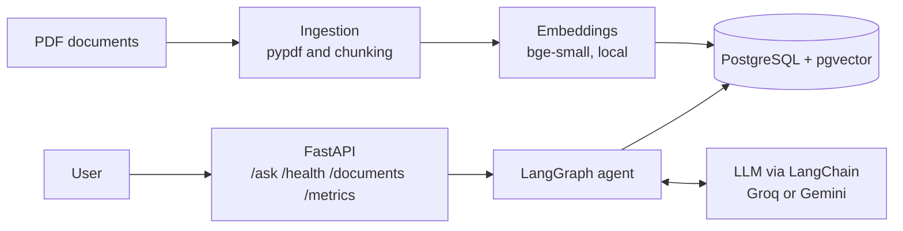
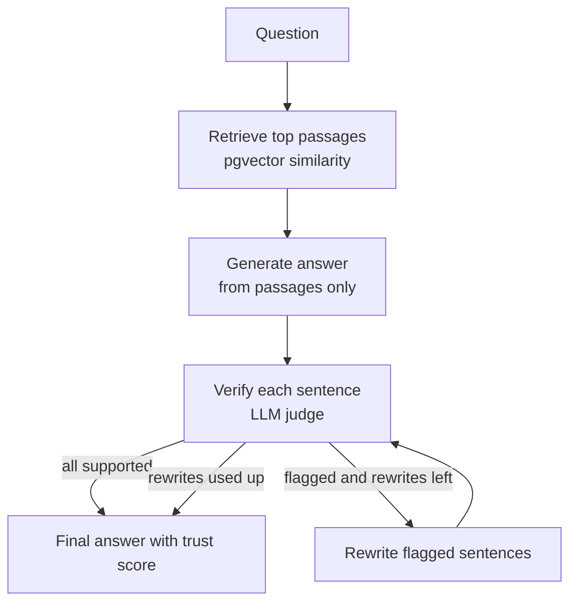

# TruthLens

A self-verifying agentic RAG system: it answers questions from your PDFs, checks every sentence against the sources, and rewrites unsupported claims.

## Status
Working: PDF ingestion, local embeddings, pgvector retrieval, a LangGraph agent that generates, verifies every sentence and rewrites unsupported claims, and a FastAPI service. Coming: hybrid search and reranking, evaluation pipeline with MLflow, CI, Docker image, Streamlit UI.

## Architecture



## The agent loop



## Run the API
```bash
uvicorn app.api:app --port 8000
# then open http://127.0.0.1:8000/docs
```

## Stack
Python, PostgreSQL + pgvector, sentence-transformers (bge-small), Google Gemini API (free tier), Docker Compose. Coming: LangGraph, FastAPI, MLflow, GitHub Actions.

## Run locally
```bash
git clone <this repo>
cd truthlens
python -m venv .venv && source .venv/bin/activate   # Windows: .venv\Scripts\Activate.ps1
pip install -r requirements.txt
cp .env.example .env                                 # add your Gemini API key and model name
docker compose up -d
python scripts/init_db.py
python scripts/ingest_pdf.py data/your_file.pdf
python scripts/ask.py "your question"
```